<div align="center">

<h1>SwarmEvolve-cyber</h1>

<h3>SwarmEvolve 벤치마크·베이스라인에 대한 보안 조사와 승인 게이트 레드팀 파이프라인</h3>

<p><a href="https://github.com/Qile-J/SwarmEvolve">Qile-J/SwarmEvolve</a>의 포크<br><sub>원 프로젝트의 코드와 결과는 원저자의 것이며, 이 포크가 더한 것은 <code>security/</code> 아래의 조사 기록과 도구뿐이다</sub></p>

<br>

<p>
  
  <br>
  <sub><i>작업 흐름. 소스 분석이 먼저이고, PoC는 소유자가 승인한 뒤에만 네트워크 없는 샌드박스에서 실행된다.</i></sub>
</p>

<br>

</div>

## 이 포크가 하는 일

[SwarmEvolve](https://github.com/Qile-J/SwarmEvolve)가 공개한 벤치마크 21개와 베이스라인 프레임워크 셋(OpenEvolve, ShinkaEvolve, CodeEvolve)을 대상으로 한 보안 조사다. `benchmarks/`와 `baselines/`는 원본 그대로이고 수정하지 않았다.

- **조사 기록** — 소스 분석으로 만든 취약점 후보, 근거, 커버리지.
- **승인 게이트 검증 파이프라인** — 후보의 PoC는 리포 소유자가 승인한 뒤에만, 네트워크 없는 샌드박스에서 실행된다.
- **레드팀 운영 설계** — 코드베이스 크기에 따라 팀 규모를 계산하고, 에이전트가 공유 보드로 발견을 주고받으며, 확인된 능력을 이어 공격 체인 가설을 만든다.

## 현재 상태

| 항목 | 상태 |
|---|---|
| 조사 run-1 (대상 커밋 `a944b3d`) | 확정 **0건**, 검증 필요 21건, 기각 2건. 대상 코드는 실행하지 않았다 |
| 검증 파이프라인 | 승인 게이트 테스트 통과, 로컬 샌드박스 자체 점검 통과. GitHub Actions 워크플로는 `main` 병합 때 한 번 실행돼 게이트 작업이 통과했고, 승인된 후보가 없어 실행 작업은 건너뛰었다. Docker로 하네스를 돌리는 작업은 아직 실행된 적이 없다 |
| PoC 하네스 | 초안 2건, 미실행. 나머지 후보 19건은 하네스가 없다 |
| 레드팀 설계 | 도구 테스트 통과. 실제 에이전트 라운드는 아직 돌리지 않았다 |
| Codex 연동 | 설정·스킬·실행기 작성, 가짜 `codex`로 실행기 테스트 통과. 실제 Codex로는 아직 실행하지 않았다 |

**후보는 확정된 취약점이 아니다.** 소스만 읽고 만든 미검증 후보이고, 대부분 벤더링된 베이스라인의 코드에 관한 것이다. 해당 프로젝트 관리자에게 알린 적은 없으며, 업스트림 최신 버전에서 이미 고쳐졌는지도 확인하지 않았다.

## 어디서부터 읽나

| 문서 | 내용 |
|---|---|
| [`security/README.md`](security/README.md) | 전체 안내와 후보 승인 방법 |
| [`security/audit/run-1/REPORT.md`](security/audit/run-1/REPORT.md) | 조사 보고서 |
| [`security/audit/run-1/NEEDS-VALIDATION.md`](security/audit/run-1/NEEDS-VALIDATION.md) | 후보 21건의 근거와 로컬 검증 계획 |
| [`security/DESIGN.md`](security/DESIGN.md) | 승인 게이트 PoC·재현 검증 파이프라인 설계 |
| [`security/redteam/DESIGN.md`](security/redteam/DESIGN.md) | 레드팀 운영 설계: seam 단위 헌터, 공유 보드, 체인 계획, 팀 규모 산정 |
| [`security/codex/DESIGN.md`](security/codex/DESIGN.md) | Codex 데스크톱·CLI에서 구동하는 방법과 한계 |

## 바로 해 볼 수 있는 것

아래 명령은 대상 코드를 실행하지 않는다.

```bash
python3 security/pipeline/verify.py list
```

```bash
python3 security/pipeline/verify.py selftest
```

```bash
python3 security/redteam/teamplan.py plan --target .
```

```bash
python3 -m unittest discover -s security/pipeline/tests
```

```bash
python3 -m unittest discover -s security/redteam/tests
```

후보를 승인해 PoC를 실행하는 절차는 [`security/README.md`](security/README.md)에 있다. 승인 없이는 아무것도 실행되지 않는다.

## 사용한 도구

[google/osv-scanner](https://github.com/google/osv-scanner), [NVIDIA/SkillSpector](https://github.com/NVIDIA/SkillSpector), [alibaba/open-code-review](https://github.com/alibaba/open-code-review), [cloudflare/security-audit-skill](https://github.com/cloudflare/security-audit-skill), [anthropics/oss-scanner](https://github.com/anthropics/oss-scanner), [JANUS-SEC/ZeroMDASH](https://github.com/JANUS-SEC/ZeroMDASH). 각 도구를 어떻게 썼고 무엇을 쓰지 못했는지는 [`security/audit/run-1/TOOLS.md`](security/audit/run-1/TOOLS.md)와 [`security/redteam/DESIGN.md`](security/redteam/DESIGN.md)에 적었다.

---

## 원 프로젝트: SwarmEvolve

> 아래는 원 리포 [Qile-J/SwarmEvolve](https://github.com/Qile-J/SwarmEvolve)의 README 내용이다. 원저자의 글과 그림을 그대로 옮겼고, 이 문서 구조에 맞추려고 소제목 단계만 한 단계 내렸다.
>
> **SwarmEvolve: Latent Agent Swarms for Rapid Evolutionary Search** — Qile Jiang and George Em Karniadakis, Division of Applied Mathematics, Brown University.
>
> 방법 개요: [애니메이션(GIF)](assets/method_overview.gif) · [자막 포함 단계별 영상(43초)](assets/method_overview.mp4)

**SwarmEvolve** is a super fast, low-cost, and capable framework for **LLM-guided evolutionary search**. It solves problems in mathematical discovery and scientific computing by refining and recombining existing programs.

**SwarmEvolve** uses **swarms of open-weight LLM agents**, hundreds of them per round, to reason in latent space. Each swarm studies the problem with a different focus and passes their KV caches to a summarizer agent that writes a new program, so the ideas of different agents combine directly in latent space.

### Results

<p align="center">
  
  <br>
  <sub><i>Qwen3 8B, one GPU, 60 minutes per run.</i></sub>
</p>

We compare SwarmEvolve with three open-source frameworks:

- **[OpenEvolve](https://github.com/algorithmicsuperintelligence/openevolve)**: A. Sharma, *OpenEvolve: an open-source evolutionary coding agent*, 2025.
- **[ShinkaEvolve](https://github.com/SakanaAI/ShinkaEvolve)**: R. T. Lange, Y. Imajuku, and E. Cetin, *ShinkaEvolve: Towards Open-Ended and Sample-Efficient Program Evolution*, International Conference on Learning Representations, 2026.
- **[CodeEvolve](https://github.com/inter-co/science-codeevolve)**: H. Assumpção, D. Ferreira, L. Campos, and F. Murai, *CodeEvolve: an open source evolutionary coding agent for algorithmic discovery and optimization*, arXiv:2510.14150, 2025.

On 21 problems from mathematical discovery and scientific computing, with Qwen3 8B, 14B, and 32B on one GPU for 60 minutes per run, SwarmEvolve achieves the highest average score with every model.

<p align="center">
  
  <br>
  <sub><i>Best score within 60 minutes, averaged over three runs. Bold: best; underline: second best.</i></sub>
</p>

### Benchmarks and baselines

- `benchmarks/problems/`: the 21 problems, each with `task.md`, `initial_program.py`, and `evaluator.py`.
- `benchmarks/evaluation.py`: the shared evaluation used to score every framework.
- `benchmarks/calibration/`: expert reference solvers for the scientific-computing problems.
- `baselines/`: OpenEvolve, ShinkaEvolve, and CodeEvolve at the commits used in the paper, with the scripts to run them on the benchmarks (`setup_baselines.sh`, then `run_baseline.sh <framework> <problem> <model>`).

### Code

The SwarmEvolve code will be released soon. For questions or early access, please reach out to the authors.
